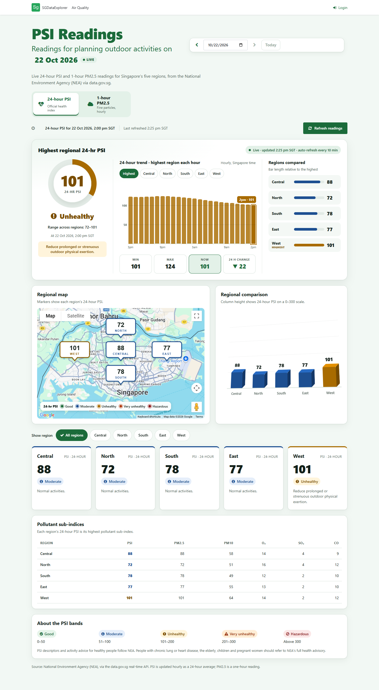
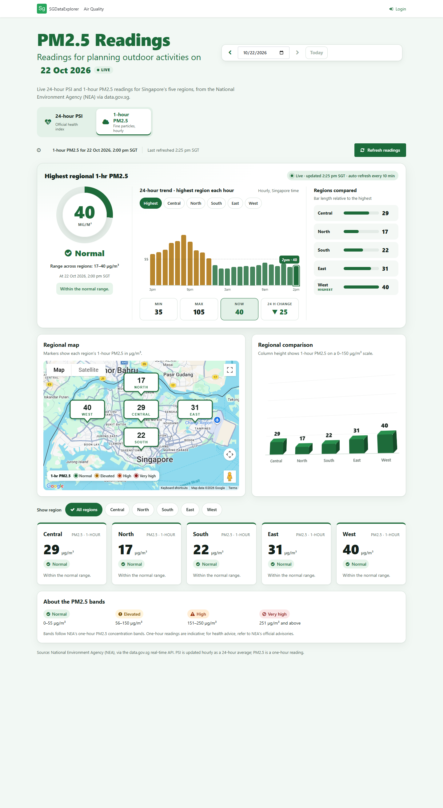
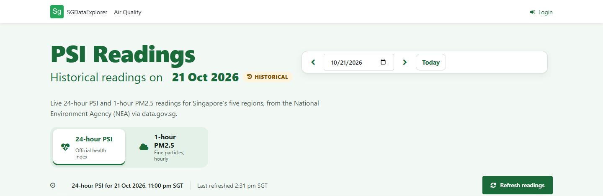
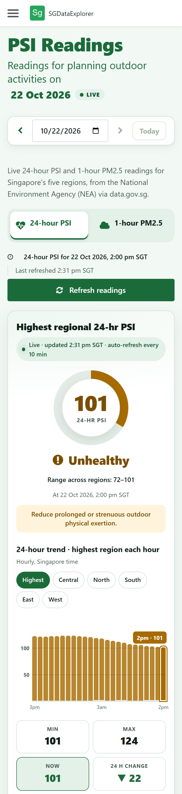

# PSIReadings — Singapore Air Quality Explorer

A public, responsive dashboard for Singapore's official air-quality readings, built as an **OutSystems 11 Reactive Web** application, plus production-grade **Terraform** for hosting the OutSystems 11 platform on AWS.

**Live application:** **<https://personal-oocjsenl.outsystemscloud.com/SGDataExplorer/>**

The dashboard shows the National Environment Agency's (NEA) **24-hour PSI** and **1-hour PM2.5** readings for Singapore's five regions, using the data.gov.sg real-time API. It includes a regional map, a 24-hour trend, regional comparisons, pollutant sub-indices and NEA health guidance. You can also look at any past date.

---

## Contents

1. [Screenshots](#screenshots)
2. [Features](#features)
3. [Repository layout](#repository-layout)
4. [Solution architecture](#solution-architecture)
5. [Application design](#application-design)
6. [Infrastructure as Code](#infrastructure-as-code)
7. [Engineering practices](#engineering-practices)
8. [Key technical decisions](#key-technical-decisions)
9. [Assumptions](#assumptions)
10. [Trade-offs](#trade-offs)
11. [Limitations and known issues](#limitations-and-known-issues)
12. [Verification](#verification)
13. [Getting started](#getting-started)
14. [Data source and attribution](#data-source-and-attribution)

---

## Screenshots

All screenshots were taken from the live application on 22 Oct 2026.

### 24-hour PSI (desktop)

The headline panel shows the highest regional reading, its NEA band and activity advice. It also has a 24-hour trend you can filter by region, plus min, max, now and 24-hour change. Below it are the regional map, a 3D regional comparison, region cards and the pollutant sub-index table.



### 1-hour PM2.5 (desktop)

The same layout, switched to PM2.5 concentrations (µg/m³) and NEA's one-hour PM2.5 bands. Trend bars are coloured by band, so the change from *Elevated* back to *Normal* is visible at a glance.



### Date selector and historical mode

Use Previous day, Next day, the date picker or Today to move between dates. Every component then reloads for the selected day. A **Historical** badge replaces **Live**, and auto-refresh pauses.



### Mobile (390 px)

On mobile the layout drops to a single column. Controls become full-width touch targets, and the page never scrolls sideways.



---

## Features

| Area | What the user gets |
|---|---|
| **Two official measures** | Tabs for the 24-hour PSI (NEA's health index) and the 1-hour PM2.5 concentration. Each uses its own NEA bands, colours, icons and guidance text. |
| **Highest regional reading** | A gauge with the band label, the range across regions, the reading time in Singapore time and the matching NEA activity advice. |
| **24-hour trend** | An hourly bar chart of the highest region, with chips to show one region instead. It has band reference lines, a scale that adapts to the values, tooltips and min/max/now/24-hour change statistics. |
| **Regional comparison** | A ranked bar list and a 3D column chart. Selecting a region in the panel, on the map or with the chips filters the region cards. |
| **Regional map** | Google Maps with a custom callout marker per region, coloured by band, plus a legend. Clicking a marker selects that region. |
| **Pollutant sub-indices** | PSI, PM2.5, PM10, O₃, SO₂ and CO sub-indices per region, which show which pollutant drives the PSI. |
| **Date selection** | Any date from 1 Jan 2016 to today, in Singapore time. All components follow the selected date. |
| **Freshness** | Readings auto-refresh every 10 minutes in live mode, and there's a manual **Refresh readings** button. Stale live data is flagged. |
| **Resilience** | A failure in one data source degrades only that part of the page. The rest still renders and the user gets a clear message. |
| **Accessibility** | Proper tab semantics with keyboard support, ARIA labels and busy states, 44 px minimum touch targets, and every colour paired with a label or icon. |

---

## Repository layout

| Path | Contents |
|---|---|
| [`docs/screenshots/`](docs/screenshots) | Screenshots of the live application used in this README. |
| `outsystems/` | The OutSystems module export (`SGDataExplorer.oml`) for opening in Service Studio. |
| [`infra/`](infra/README.md) | Terraform for self-managed OutSystems 11 on AWS (Dev, Test, Prod and LifeTime), with tests, runbooks and a task runner. The [infra README](infra/README.md) is the full operator guide. |
| [`.github/workflows/infra-terraform.yml`](.github/workflows/infra-terraform.yml) | CI/CD: validation and tests, a plan per environment on pull requests, and approval-gated apply on `main`. |
| [`.pre-commit-config.yaml`](.pre-commit-config.yaml) | Local hooks: fmt, validate, tflint, Checkov, terraform-docs and secret detection. |

---

## Solution architecture

```
                         ┌──────────────────────────────────────────────┐
  Browser (desktop /     │  SGDataExplorer — OutSystems 11 Reactive Web │
  mobile, anonymous) ───►│                                              │
                         │  Client (React runtime)                      │
                         │   • AirQuality screen, 4 reusable blocks     │
                         │   • band / colour / formatting functions     │
                         │   • trend merge, date logic, auto-refresh    │
                         │            │ data actions (async)            │
                         │  Server    ▼                                 │
                         │   • "never-throw" server actions             │
                         │   • REST integration (cached 5–10 min) ──────┼──► api-open.data.gov.sg
                         │   • site properties (secret API keys)        │      /v2/real-time/api/{psi,pm25}
                         └──────────────────────────────────────────────┘
                                        │ Maps JS (OutSystems Maps component)
                                        └────────────────────────────────────► Google Maps Platform
```

- **Hosting today:** the live demo runs on an OutSystems Cloud personal environment.
- **Hosting for production:** [`infra/`](#infrastructure-as-code) defines the AWS platform a self-managed OutSystems 11 installation would need: Dev, Test and Prod environments plus a LifeTime environment.

---

## Application design

### Layers

| Layer | Elements | Responsibility |
|---|---|---|
| **Integration** | `DataGovRealtime` REST API with `GetPSI`, `GetPM25` and `GetByDate(Metric, Date)` | Calls data.gov.sg. Live calls are cached for 5 minutes and date calls for 10 minutes, which keeps the app well within the API's rate limits. An optional `x-api-key` header is filled from a site property. |
| **Data mapping** | Structures `PSIResponse/PSIItem/PSIReadings`, `PM25Response/…`, `RegionValues`, `TrendPoint`, `PSISnapshot`, `AirQualitySnapshot` | Typed models built with `NameInJSON` mappings, decoupled from the raw JSON shape. Region values default to `-1` to mean *no reading*, so a missing region is never shown as 0. |
| **Server logic** | `AirQuality_GetPSI`, `AirQuality_GetLatest`, `AirQuality_GetPSIForDate`, `AirQuality_GetPM25ForDate`, `AirQuality_GetHistory`, `Maps_GetConfig` | Every action **never throws**. Each returns `IsSuccess` and `ErrorMessage`, so the UI decides how to degrade. For a past date, the latest-timestamp item of that day is selected. |
| **Domain rules** | `PSI_Band*` and `PM25_Band*` client functions (level, label, class, icon, colour, guidance), `FormatSGTime`, `AQ_MarkerPin` | NEA band rules are defined once and reused by every component. Times are always rendered in Asia/Singapore, whatever the viewer's time zone. |
| **Presentation** | `AirQuality` screen, `HighestReadingPanel`, `MetricCard`, `MapLegend` and `PageHeaderStyles` blocks | Reusable blocks raise events such as `RegionSelected`, so the screen stays the single owner of state. |

### Data flow

1. On load, `OnInitialize` works out today's date in Singapore time. The `GetPSI`, `GetPM25` and `GetMapConfig` data actions run in parallel.
2. `ApplyPSI` and `ApplyPM25` copy the results into the screen's snapshot variables and record failures and staleness.
3. `AfterReadings` rebuilds the map markers and requests history on demand.
4. `ComputeTrend` merges the selected day with the previous day, sorts the result and keeps the last 24 hourly points.
5. A date change, through `ChangeDate`, `ShiftDate` or `GoToday`, sets `SelectedDate` and refreshes every data action. An empty `SelectedDate` means *live*.
6. `AutoRefresh` runs every 10 minutes. It skips a run while a refresh is in flight or a past date is selected.

### Presentation choices

- **Bands from NEA:**
  - PSI: 0–50 Good, 51–100 Moderate, 101–200 Unhealthy, 201–300 Very unhealthy, >300 Hazardous.
  - One-hour PM2.5: 0–55 Normal, 56–150 Elevated, 151–250 High, ≥251 Very high.
- **Markers:** generated SVG callouts, served as data URIs. They need no image assets, scale cleanly and are coloured per band.
- **Design system:** a green palette with CSS custom properties on the screen and blocks. Colour is never the only signal: every band also has a label and an icon.

---

## Infrastructure as Code

[`infra/`](infra/README.md) is Terraform for running a **self-managed OutSystems 11** installation on AWS. This is the production hosting model an enterprise would use instead of an OutSystems Cloud personal environment.

| Concern | Implementation |
|---|---|
| **Topology** | Dev, Test, Prod and LifeTime, each a separate instance of the same `stack/` root with its own VPC, KMS key, secrets, ALB, controller, front-end Auto Scaling group, RDS for SQL Server and state file. |
| **Modules** | `network`, `security`, `database`, `edge` (ALB, WAF, ACM), `platform` (controller and front-ends), `observability` and `dr-backup`, plus an account `bootstrap`. |
| **Security** | No credentials in code or state: the RDS password is managed by RDS in Secrets Manager. A customer-managed KMS key per environment. No inbound admin ports (SSM only). Least-privilege security groups that follow OutSystems server roles. TLS 1.2/1.3, IMDSv2 and WAF. CI uses GitHub OIDC with no stored AWS keys. An account guard stops runs against the wrong AWS account. |
| **Reliability** | Multi-AZ RDS and three AZs with a NAT gateway per AZ in Prod. AWS Backup with cross-region copies. Point-in-time recovery. Deletion and termination protection. |
| **Guardrails** | `stack/guardrails.tf` fails the plan if Prod or LifeTime falls below the production baseline. |
| **Delivery** | `make check` runs fmt, validate, `terraform test` (56 test cases across modules and environments), tflint, Checkov and the terraform-docs drift check. CI runs the same checks, plans each environment on pull requests, and applies only through approval-gated GitHub Environments. |
| **Operations** | Runbooks for scaling, patching, golden AMIs, backup and restore, disaster recovery, secret rotation, certificate renewal, monitoring and teardown. They're in the [infra README](infra/README.md#operations-runbooks). |

The Terraform is fully validated offline but **has not been applied to an AWS account**. The live demo does not depend on it.

---

## Engineering practices

- **Plan before change.** Each feature was proposed and approved before implementation. Changes were then made in small increments, published, and checked on the live site.
- **Single source of truth for domain rules.** NEA bands, colours, labels and guidance live in one set of functions. The gauge, chart, map, cards and table can't disagree.
- **Fail soft, never crash.** Server actions return status instead of throwing. Each panel handles its own failure, and stale data is flagged rather than hidden.
- **Secrets out of the model.** API keys are secret site properties set per environment in Service Center, never stored in the module or the repository. The same rule applies in `infra/`, which uses Secrets Manager placeholders and OIDC.
- **Caching at the integration boundary.** Short REST caches protect the upstream API and keep the app fast for many concurrent viewers.
- **Accessibility and responsiveness as requirements.** Tab semantics, keyboard support, ARIA, touch-target sizes and no horizontal scroll were all checked at 375–390 px and on desktop.
- **Infrastructure tested like code.** Module unit tests, environment tests, policy guardrails, linting, security scanning, generated documentation, pinned versions with committed lock files, and pre-commit hooks.
- **Documentation as a deliverable.** This README covers the decisions. The infra README is an operator guide, with prerequisites, a step-by-step deployment, runbooks and troubleshooting.

---

## Key technical decisions

| Decision | Alternatives considered | Reasoning |
|---|---|---|
| **OutSystems Reactive Web** | Traditional Web; a separate SPA | Reactive gives a client-side React runtime: fast tab and date switching, asynchronous data actions and a native mobile-friendly layout. |
| **Call data.gov.sg from server actions, not the browser** | Calling the API directly from client JavaScript | Keeps the optional API key server-side, enables platform-level caching and avoids CORS. It also gives one place to normalise the response. |
| **Never-throw server actions** | Raising exceptions to the client | One failing source, such as PM2.5, shouldn't blank the whole page. Returning status lets each component degrade on its own. |
| **24-hour PSI as the headline** | Showing only PM2.5 | The 24-hour PSI is NEA's official health index for planning activities. One-hour PM2.5 is offered as the faster, more responsive signal. |
| **"Readings", not "Forecast"** | Labelling the page "PSI Forecast" | data.gov.sg publishes measured readings, not forecasts. The wording stays accurate so users don't plan on a forecast that doesn't exist. |
| **Generated SVG markers** | Image assets; default pins | Each marker shows the value, region and band colour with no asset pipeline, and stays sharp at any zoom. |
| **Empty `SelectedDate` means live** | A separate live/historical flag | One variable drives every data action, the badge and auto-refresh, so live and historical can't drift apart. |
| **Bounded date range (2016–today)** | Unrestricted input | Avoids requests for dates with no published data and for future dates. |
| **Terraform with one stack and per-environment tfvars** | A separate root per environment; CDK or CloudFormation | Environments can't drift structurally, but each keeps its own sizing and isolated state. Terraform's `terraform test` and its ecosystem (tflint, Checkov, terraform-docs) make the infrastructure testable without an AWS account. |
| **SSM-only administration** | A bastion host or RDP | Removes every inbound admin port, and SSM records sessions for audit. |

---

## Assumptions

- **Audience:** the general public, so the dashboard allows anonymous access with no login. NEA's guidance is shown as published, for healthy people, with a pointer to NEA's full advisory for sensitive groups.
- **Data:** data.gov.sg is the authoritative source and publishes hourly. Readings are presented as-is, with no smoothing or interpolation.
- **Time:** all times are Singapore time (UTC+8), whatever the viewer's location.
- **Infrastructure:** the AWS design targets a self-managed OutSystems 11 installation in `ap-southeast-1`, with `ap-southeast-2` for DR. Account IDs, domains and hosted zones in `infra/envs/*/terraform.tfvars` are placeholders marked `REPLACE`.

---

## Trade-offs

| Choice | Benefit | Cost |
|---|---|---|
| 5–10 minute REST cache | Protects the upstream API and scales to many viewers | Readings can be up to one cache window behind the source. This is acceptable for hourly-published data. |
| No API key by default | Zero setup | Lower upstream rate limits. A key can be added through the `DataGovApiKey` site property without a code change. |
| Hand-built charts in HTML and CSS | No chart-library dependency, full control of accessibility and theming | More markup to maintain than a charting library |
| Previous-day fetch for the trend | A true rolling 24 hours, even just after midnight | Two upstream calls instead of one, mitigated by caching |
| Single controller instance on AWS | Simpler, and matches OutSystems' controller model | Recovered from backup rather than clustered |
| Licence-included RDS SQL Server | No licence management | It's the largest cost driver, especially Multi-AZ in Prod |

---

## Limitations and known issues

- **The historical 24-hour trend is unavailable.** On past dates, the trend panel says *"The 24-hour trend is unavailable right now"*, although data.gov.sg returns the hourly data for those dates. Everything else on the page loads normally for past dates. The cause is in the app's history and trend logic and is still open.
- **No 3D map tilt yet.** The tilted map view needs a Google Maps *Map ID*. The `GoogleMapId` site property isn't set, so the map renders flat.
- **Free-tier hosting.** The demo runs on an OutSystems Cloud personal environment, which may sleep when idle. The first visit after a pause can be slower.
- **Readings, not forecasts.** The source has no forecast data, so the app can't predict future air quality.
- **Infrastructure not applied.** The Terraform is validated and tested offline only. Installing OutSystems and registering environments in LifeTime are documented manual steps, covered in the [infra README](infra/README.md#5-install-outsystems-11-post-provisioning).

---

## Verification

**Application** (manual, against the live site):

- Regional values were checked against the raw data.gov.sg responses. For example, 21 Oct 2026 at 11:00 pm SGT: Central 106, North 79, South 88, East 90, West 123, matching the historical screenshot data.
- Layout was checked on desktop at 1440 and 1880 px and on mobile at 375 and 390 px.
- Tab switching, region filtering from the panel, map and chips, date navigation, and the Refresh busy state were all exercised.

**Infrastructure** (automated, `make check`): `terraform fmt -check`, `terraform validate`, `terraform test`, tflint, Checkov and the terraform-docs drift check all pass. The same suite runs in CI on every pull request.

---

## Getting started

### Use the application

Open **<https://personal-oocjsenl.outsystemscloud.com/SGDataExplorer/>**. No account is needed.

### Open the module

1. Install **OutSystems Service Studio 11** and connect to an OutSystems 11 environment.
2. Open `outsystems/SGDataExplorer.oml`, then publish it (**1-Click Publish**).
3. Make sure the **OutSystemsMaps** component is installed in the environment.
4. Optionally, in Service Center → *SGDataExplorer* → *Site Properties*, set:
   - `GoogleMapsApiKey` (needed for the map);
   - `GoogleMapId` (enables the 3D tilt);
   - `DataGovApiKey` (gives higher data.gov.sg rate limits).

### Validate the infrastructure

No AWS credentials are needed:

```bash
cd infra
make check
```

For a real deployment, follow [infra/README.md](infra/README.md#quick-start): bootstrap the state backend, configure an environment, plan, apply, fill the secrets and install OutSystems.

---

## Data source and attribution

Air-quality data comes from the **National Environment Agency (NEA)** through the [data.gov.sg](https://data.gov.sg) real-time API, under the Singapore Open Data Licence. Maps are provided by **Google Maps Platform**. PSI is updated hourly as a 24-hour average; PM2.5 is a one-hour reading.
